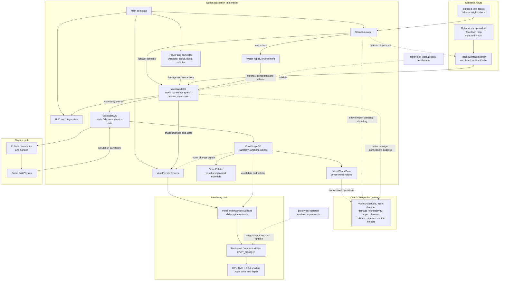

# Teardown-style voxel architecture

## System architecture at a glance



The solid arrows show runtime ownership or data flow; dotted arrows show native helper calls,
notifications, or supporting project areas. The optional map is supplied by the user and is not
included in the repository. Rendering and collision are separate consumers of the same voxel
shapes: the renderer updates GPU atlases, while the physics path builds Jolt collision.

## Renderer decision

The project uses **Vulkan 1.2 through Godot Forward+ and its global `RenderingDevice`**. It does not
call Vulkan directly.

The proxy-box and `spatial shader` experiment was discarded: entering a volume disabled early-Z and
raised the pass to about 54 ms. The selected backend is a `CompositorEffect` at `POST_OPAQUE`, with
a full-screen triangle, a Shapes BVH, and Amanatides-Woo DDA. It is the only backend connected to
`main.tscn`; the spatial prototype remains only as reproducible evidence.

The dedicated pass:

- reads resolved Forward+ color and depth;
- traverses a GPU BVH first, then the candidate Shape's dense volume;
- skips empty 8x8x8 macrocells before running fine 10 cm DDA;
- writes reverse-Z color and depth to coexist with the ground, player, and opaque meshes;
- converts MagicaVoxel RGBA color from sRGB to linear before writing to the HDR buffer;
- reads roughness, metallic, and emission from the second half of the GPU palette row;
- runs a second alpha-blended pass without depth writes only when `MATL` declares visually
  transparent glass;
- lets Godot's conventional transparencies render after the voxel pass.

### Map water

`VoxelWaterSystem` imports Teardown `<water type="polygon">` elements as a single `ArrayMesh`
surface. It does not voxelize the sea or redraw the scene with a specular camera. A material
rendered after the opaque pass reuses screen color/depth for refraction, absorption, shallow-water
foam, and its own eight-step SSR; a second batched mesh creates irregular shoreline foam and raises
the water surface by 1.8 cm to avoid z-fighting with voxel faces. Two samples of a 128×128 normal
map with eight oblique domain-warped waves add motion without 90° symmetry. The sky and sun from
`<environment>` resolve rays that leave the screen.

Lee contains three polygons, 20 triangles, and 266,246.88 m², grouped into one surface draw and one
shoreline draw. The A/B measurement on a Radeon Pro 5300M is +0.273 ms median GPU / +0.798 ms P95
and +0.037 ms render CPU. No mesh reconstruction is performed: buoyancy queries only awake Bodies
at 30 Hz, splashes use a single GPU emitter, and 24 waves share a MultiMesh. The player swims with
hysteresis near the surface.

## Data model

```text
VoxelWorld3D
└── VoxelBody3D                 static, dynamic, or retired state
    ├── StaticBody3D/RigidBody3D (Jolt)
    ├── VoxelShape3D           transform, anchors, and palette
    │   └── VoxelShapeData     cropped dense volume, 1 byte/voxel, 0 = air
    └── VoxelShape3D ...
```

`VoxelShapeData` and configuration resources live in the C++ GDExtension. The extension is compiled
locally for the host's macOS architecture; generated binaries are not versioned. The dense volume
is canonical; 8x8x8 macrocell occupancy is derived data for DDA, dirty regions, and collision.

### Native runtime modules

The extension does not duplicate `VoxelWorld3D` as another monolith. Pure CPU paths are split by
responsibility, while GDScript adapters retain only ownership and scene APIs:

- `VoxelRuntimeRegistry`: incremental mirror of Bodies/Shapes, O(1) metrics, coherence, baked
  pending work, awake list, and budget planning;
- `VoxelDamagePlanner`: material damage, local disconnection guard, and selection of components to
  materialize;
- `VoxelStructuralGraph`: connected groups and exact traversal to foundations; geometric checks
  still use `VoxelShapeData`'s native indices;
- `VoxelRopeSolver`: Verlet buffers, constraints, sleeping, breaking, tension, batched collision
  queries, and mesh arrays;
- `VoxelMapImportPlanner`: named XML/VOX parsing, bounds, and joint classification;
- `VoxelMapSceneTraversal` and `VoxelMapSceneCommitter`: recursive XML composition and main-thread
  commit of Bodies/Shapes, including creation from Script resources, configuration, parenting, and
  connection to baked collision;
- `VoxelAssetDecoder`: generic MagicaVoxel parser, `nTRN/nGRP/nSHP` graph, cropping, expansion,
  emptying, and anchors; the adapter retains only sidecars and material policy;
- `VoxelRopePhysicsBridge`: performs raycasts and applies forces in a single native physics-tick
  call;
- `VoxelTransformTracker`: resolves awake IDs, gives sleeping bodies a grace frame, and captures
  interpolated transforms/bounds for rendering and shadows;
- `VoxelCollisionInstaller`: creates `CollisionShape3D`, boxes, and concave resources in batches;
- `VoxelShadowUpdatePlanner`: round-robin, deadband, Shape state, removed-item sweep, and bounded
  region coalescing during bursts;
- `VoxelMotionDamageScanner`: 30 Hz census, kinetic-energy prioritization, cooldown, and bounded
  contact checks against pass-through geometry;
- `VoxelMassProperties`: compound mass, center, oriented/parallel-axis inertia, and damping;
- `VoxelSupportPlanner`, `VoxelImpactQueue`, and `VoxelCollisionHandoffQueue`: separate support
  planning and the two state machines previously housed in `VoxelWorld3D`.

The data kernels (`VoxelRuntimeRegistry`, `VoxelDamagePlanner`, `VoxelStructuralGraph`,
`VoxelRopeSolver`, `VoxelAssetDecoder` y `VoxelMapImportPlanner`) no llaman al SceneTree. Los
`VoxelRopeSolver`, `VoxelAssetDecoder`, and `VoxelMapImportPlanner`) do not call the SceneTree. The
scene bridges—commit, movement, shadows, collision, transforms, and ropes—are also `Resource`s, but
they access Nodes, `PhysicsDirectSpaceState3D`, or Jolt and therefore are called exclusively from
the main thread/physics tick. This separation follows Godot's official contract: the active
SceneTree is not thread-safe, and direct GPU operations may synchronize. Jolt already uses
`WorkerThreadPool` internally; adding another pool around the tick does not increase that
parallelism and instead introduces waits and races.

`VoxelPalette` supports 255 materials and stores color/opacity, roughness, metallic, emission,
hardness, density, friction, and restitution. The renderer uses each voxel's actual index and its
Shape's palette row. Damage and physics read material properties from the same palette.

In Teardown maps, physical material and appearance are resolved separately, as required by the
authoring format:

- the palette-index band determines glass/vegetation/wood/masonry/metal and therefore hardness and
  density;
- `RGBA` preserves the exact sRGB color;
- `MATL._type`, `_rough`, `_metal`, `_alpha`, `_emit`, and `_flux` determine visual appearance;
- a voxel in the physical glass band can use `MATL _metal` and appear opaque; conversely, a reserved
  index can use `MATL _glass` and appear transparent;
- `voxbox` reads color, physical material, and its `pbr` tuple from XML.

Transparency used to be derived from the physical band. This turned walls and metal pieces in the
Lee map into glass, while some actual glass remained opaque.

`VoxelAssetDecoder` accepts `SIZE`, `XYZI`, `RGBA`, `MATL`, `nTRN`, `nGRP`, and `nSHP`, transforms
MagicaVoxel Z-up to Godot Y-up, and the adapter accepts the `<asset>.voxel.json` sidecar. It does
not downsample `.vox` files at runtime. Legacy 30 cm planes are adapted once into 3x3x3 blocks of
10 cm voxels.

## Destruction

`VoxelWorld3D.damage_sphere(center, radius, energy)` performs this sequence:

1. queries the immutable static-Shape grid and the grid of awake dynamic Shapes;
2. applies hardness and per-voxel material attenuation;
3. writes air and emits the dirty box;
4. updates the atlas, macrocells, clipmaps, and collision only in the affected region;
5. checks the local crater boundary in C++; only if a cut is possible does it run global
   six-face-connectivity classification;
6. keeps components connected to anchors in the static body;
7. converts the others into particles or new dynamic `VoxelBody3D`s.

There is no tension, compression, load, balance, or overhang solver in the voxel volume. The rule is
deliberately binary and 6-connected: if a component retains at least one face-connected path to a
live root, it remains static; if it loses the last path, it falls. There are no foundation
percentages, minimum thicknesses, or building-type exceptions. A real one-voxel neck remains a
path; simulating its failure under load would require a separate stress subsystem.

Roots can be explicit (`anchor_indices`), indestructible internal material
(`hardness >= FOUNDATION_HARDNESS`, such as `rock`/`heavymetal`), or a material path to another
static Shape that reaches a root. `_reaches_foundation` has no limit that returns "supported" when
exhausted: even a long search completes exactly. `RETIRED_STATIC` does not count as support.
Collision, AABBs, and proximity only generate candidates; `touches`/`component_touches` verify live
voxels on both sides.

The root cache is not an eternal boolean: each `VoxelShape3D` stores the exact number of live
foundation voxels and the revision for which it was calculated. `VoxelShapeData` maintains a
256-material histogram, so removing the last stone invalidates support in O(1) without traversing
an entire tower or terrain again. This data lives with the Shape, not the World, so it cannot
survive an ownership change or mutation with a new revision.

Before a change, destruction retains only contacts that cross the crater's local cube. It then
classifies once in C++ and checks external support for components without their own root. Pairs
whose links crossed the crater are revalidated at 9 cm; authored links farther away retain the
12 cm clearance Lee needs. These separate margins prevent a fence from crossing the freshly
removed voxel due to tolerance, without prematurely dismantling a tower's head and mast.
`_static_contacts` continues to cache paths between Shapes; `_contact_users` invalidates the cache
in both directions.

An entire unsupported chain becomes dynamic as **a single** `RigidBody3D` (`_merge_dropped_chain`),
without the old Shape-count limit that turned a 40-section pipe into 40 bodies in the worst frame:
anything destruction has not separated remains one piece, even if the map authored it as several
distinct `<vox>` elements with one body each. If a cut occurs within a Shape and the new fragment
touches other Shapes authored away from the crater—for example, a power-tower head—
`_absorb_static_continuations` follows those intact connections, rejects any path that still reaches
a root, and transfers the continuation to the same dynamic body. This prevents a static head from
remaining suspended or an artificial joint from forming between parts that are still visually
welded together.

`damage_sphere` also separates Shapes in the same `<body dynamic>` that have stopped touching
(`_split_loose_shapes` + `_contact_groups`), for chains of pipe sections that Teardown welds into a
single rigid body. Grouping respects the authored weld baseline (`_capture_weld_baseline`, recorded
when the body is registered): Shapes that **never** touched are connected by the map author, and
destruction separates only what it actually disconnects.

Visual impact does not create one `RigidBody3D` per removed voxel. The native operation keeps a
deterministic reservoir of up to 256 removed positions/materials, and the pool composes the effect:

- reusable voxel chips with gravity, rotation, bounce, and material color;
- GPU-simulated billboard dust with expansion, drag, and fade;
- sparks or shards for metal, glass, and especially hard materials;
- camera trauma/recoil attenuated by distance;
- components of 8+ voxels as Jolt Bodies when they affect gameplay.

Per-impact limits are 96 chips, 128 dust particles, and 32 sparks. This separation follows
Teardown's observable model: geometry/volumes preserve permanent destruction, while `plain
particles`/smoke provide short-lived local feedback without becoming physics bodies.

The static grid index is completed during import: static damage does not invalidate it because
editing cells does not change the Shape's outer bounds. Collision rebuilding also does not happen
inside the damage call. Dirty blocks are deduplicated and `VoxelWorld3D` submits at most one per
frame to Jolt; the visual atlas remains immediate.

Component classification and planning live in C++ and traverse contiguous memory: they take a
read-only pointer to the volume, use a `std::vector` queue, and materialize each
`PackedInt32Array` only once. The global physics budget and Body count are maintained incrementally
in `VoxelRuntimeRegistry`, not by a GDScript scan during a shot; a temporary 192-Body window applies
during that interval. Dynamic Shapes are queried through an 8 m grid; only awake Bodies update their
cells at 10 Hz. In the Lee map, this replaces traversing every imported prop (about 5 ms per shot)
with queries of only overlapping cells (0.10–0.20 ms in the final test).

Global classification also uses an exact incremental index of 8³ macrocells. Each block retains
its local components and six-face ports; damage rebuilds only the touched block and its neighboring
edges. The compact graph determines support and materializes only voxels in an island that actually
detaches. A negative local guard avoids the global query; a positive result is confirmed against
global roots to detect paths that leave and re-enter the window. If the index is invalid, the
historical flood fill runs. `verify_connectivity_in_debug` allows sampled comparison without
incurring that cost in production.

## Compiled immutable-map loading

The XML and VOX files remain the source of truth. On the first full load with collision,
`TeardownMapCache` stores the statically merged greedy-meshed faces in
`user://compiled_teardown_maps`. A `PackedScene` is not used: live voxel data, `Body`/`Shape`
relationships, joints, and ropes still need to be constructed, and serializing nodes does not by
itself avoid inserting physical Shapes into Jolt. The derived artifact reuses exactly the face
generation phase without creating a second importer or sacrificing later destruction.

The key includes the format and Godot versions, XML size/date, all VOX files, and the files that
implement importing, collision, and physics. Changing the map or that code produces a new key and
therefore triggers an automatic rebuild. The cache is never distributed with the project and does
not modify original files. `--rebuild-teardown-cache` forces a cold measurement,
`--no-teardown-cache` disables the path, and `--eager-teardown-cache` installs all collision during
loading for comparison.

During a warm load, collision within 45 m of the spawn point is installed synchronously. The rest
is ordered by distance from the camera and enters Jolt only within 80 m, with a 1.5 ms frame budget.
If a Shape takes damage or its Body becomes dynamic, its pending blocks are removed first: an old
compiled face can never reappear over destroyed geometry.

## Jolt physics and budgets

Anchored bodies use `StaticBody3D` and invisible concave surfaces rebuilt per dirty macrocell.
Fragments use `RigidBody3D` and box compounds. Native greedy decomposition tests exact 10 cm
increments. If it exceeds the limit, each reduced macrocell receives an AABB fitted to its actual
voxels: the entire 20/40/80 cm cube is no longer filled, nor are reduced cells merged across empty
space. That filling could create an invisible ledge under a tower. `VoxelMassProperties` calculates
mass, center of mass, and inertia from densities and occupied voxels. For Bodies with multiple
Shapes, inertia is rotated into the Body axes and summed using the parallel-axis theorem; summing
only intrinsic inertia made a long post rotate like a compact object. Dynamic Bodies use
`VoxelImpactRigidBody3D` with eight monitored contacts: `_integrate_forces` only adds the dominant
contact and defers destruction to the World, outside Jolt's step.

`VoxelBody3D` remains the structural and authored unit, but its static collision is divided among
spatial `StaticBody3D`s of 2×2×2 macrocells (at most eight concave surfaces). Previously, tens of
thousands of blocks were children of a single `StaticBody3D`: its AABB covered the whole map, and
a large dynamic compound forced the narrow phase to test all its children. Sharding preserves the
same geometry and per-macrocell updates, while allowing the broad phase to discard distant regions.
At the real dam tower, a collapse of 266 boxes dropped from 66.36 ms to 8.69 ms physics P95 without
reducing the compound or changing destruction.

The normal per-Body limit is 64 boxes. The builder does not fill the remaining volume: it increases
the pitch and preserves an AABB fitted to each occupied cell. In Lee's large-collapse probe,
lowering the limit from 128 to 64 reduced 84 effective children to 28, preserved structural
collapse, and reduced physics P95 from 7.14 to 6.46 ms. Requesting 32 did not simplify that piece
further and worsened P95, so 64 is a measured threshold, not an arbitrary reduction.

Damage to a dynamic Body queues only one compound rebuild per frame. Transferring several Shapes to
the same fragment uses batched insertion and rebuilds at the end, avoiding the O(n²) pattern of
rebuilding the compound after every `add_voxel_shape`.

### Ownership, revisiones y handoff

During gameplay, `VoxelWorld3D._finalize_detached_bodies` is the only detach commit. Immediate
fragments and those exceeding the per-frame limit of three retain the same source Body, revision,
component, bounds, state, explosion, and transaction ID. Both absorb unsupported static
continuations before emitting `body_split`; global support reevaluations wait until that queue is
finished. This fixes the Lee tower roof, which could become dynamic through a different path and
remain suspended.

If several structural Bodies in the same batch previously belonged to one rigid family and still
have material contact, they are coalesced once before their handoffs are released. Waiting for each
fragment to activate allowed two pieces of the same tower to receive divergent impulses and lose
contact before grouping. Each Shape's lineage prevents rewelding two halves of the same volume
separated by the crater; family identity prevents joining rubble or buildings that merely collided
during the explosion.

Static-to-dynamic separation uses an explicit handoff. A fragment is created frozen, with collision
filters set to zero. Dirty static blocks disable their old `CollisionShape3D`s when the rebuild is
queued; after that retirement and a safety physics tick, the fragment's filters are restored, it is
unfrozen, and its stored impulse is applied. The corrected rebuild remains prioritized and
reenables each block as its faces are installed. Separating "old geometry retired" from "revision
fully cooked" avoids both duplicate collision and fragments frozen for hundreds of frames on a
large map. Cancelling a handoff because its Body was retired never reactivates its layers, so no
ghost collider appears during end-of-frame `queue_free`.
The same rule applies to an entire tower or post changing from `StaticBody3D` to `RigidBody3D`, even
when there is no partially cropped source Shape. CCD remains enabled for posts, small pieces, and
fast bodies; a large tower below 14 m/s disables it to avoid sweeping each of its boxes against
concave meshes every tick. Sleeping authored props do not incur that cost.

Physical collisions produce bidirectional damage through a deduplicated queue of 16, with at most
two jobs or 4 ms per frame. Radius and penetration derive from impulse×velocity; attacker and
receiver are added explicitly even if the dynamic index has not yet updated their transforms. Trees
and other non-solid materials still have no Jolt faces, but an exact pass at 30 Hz (at most eight
native checks) lets a metal tower pass through and damage them.

`VoxelShapeData.content_revision` changes with every real mutation. `VoxelShape3D` records the last
notified revision, `VoxelBody3D` the last collision revision, and a `physics_generation` for each
Jolt Body replacement. The contact cache validates the revision, generation, and pose of both
ends. The World snapshot reports `COHERENT`, `PENDING`, or `DESYNC`; a native mutation that bypassed
the wrapper is diagnosed and schedules a safe full rebuild. `VoxelRuntimeRegistry` retains the
canonical data reference to detect rogue writers as well, but queries pending items through an
`unordered_set`, removing the old O(Shapes × baked queue) pattern. The same snapshot identifies the
canonical revision, collision revision, and first stale consumer.

Joints, ropes, and doors no longer write a shared persistence boolean. Each constraint or endpoint
acquires an identified hold; breaking one does not release the others. `body_split` transfers
ownership before unregistering the old owner, and `body_unregistered` removes any references with
no heir. This includes the reverse joint index, rope endpoints, and door-interaction metadata.

Concave surfaces are also merged with coplanar greedy meshing: a solid 64x64 voxel sheet supplies
two triangles to Jolt, not 8,192, without changing or raising the surface. Static blocks are at
most 3.2 m; compared with the former 6.4 m limit, this adds only 4.1% more Shapes in Lee and bounds
rebuilding a damaged region.

Initial `VoxelPhysicsBudget` values:

| Limit | Value |
|---|---:|
| Recommended awake Bodies | 128 |
| Bodies during explosions | 192 |
| Boxes per Body | 128 |
| Global active boxes | 8192 |
| Component converted to particles | 1–31 voxels |
| Structural fragment | 64+ voxels |
| Reversible static retirement | 1.5 s asleep |

Isolated components of up to 31 voxels spawn directly as pool chips; from 32 voxels up they remain
rigid, grabbable debris. A small connector that still touches a static continuation always spawns
as a Body so it can absorb that continuation. When a burst exceeds these limits, only cosmetic
fragments smaller than 64 voxels are immediately converted to the visual pool. Structural
components are not frozen or removed to force compliance with the budget.

The overlay reports `awake_bodies`, **active** boxes against the budget, total diagnostic boxes,
`collision_rebuild_ms`, pending blocks, and `retired_bodies`. Retired fragments return to
`RigidBody3D` when damaged.

`_box_allowance_for_new_body()` allocates the active-box limit against `awake_compound_boxes`, not
the total box count across all dynamic bodies. A Teardown map imports hundreds of sleeping props
that cost Jolt nothing but still count as "existing boxes"; subtracting them from the global limit
left only one box available for any newly dynamic body, regardless of size. A 24 m tower with 9,600
voxels became a single solid block with the wrong shape: it would not fall because the block
remained supported, and it could not be hit reliably because its only box did not match the visible
voxels.

## Teardown maps: live bodies, joints, and ropes

`teardown_map_importer.gd` converts a Teardown `.xml` file into the project's `Body`/`Shape` model.
`<body dynamic="true">` marks a body as live from the start, not as something activated only by an
explosion: in the reference map (Lee, 632 of 635 `<body>` elements), these are ropes, pipes, loose
boxes, and posts that Teardown simulates at rest like any other object.

Four of those markers are inside `<script>`. The importer traverses their children even though it
ignores Lua logic; returning at that node was why only 628 appeared before. The report separates
`authored_dynamic_bodies` from `imported_dynamic_bodies`, and the full census requires 632/632.
Lee's 38 `density` attributes multiply their Shape's mass and inertia and survive a detach.

Imported mass separates two concepts that voxel volume alone cannot distinguish:
`density_scale` literally preserves the XML `density` multiplier, while `physical_fill_scale`
represents how much of the voxel-bounded volume is actual material. Authored props inside
`<body dynamic="true">` use `physical_fill_scale = 0.025`. A supported structure retains `1.0` as
its volumetric truth; when it becomes a dynamic fragment it adopts `0.10`, representing beams,
broken masonry, and hollow framing instead of treating them as a solid block. This calibration
puts Lee's three reference vehicles at 847, 1,533, and 1,820 kg, a 1 m³ wooden box at 17.5 kg, and
a 0.25 m³ metal tank at 48.75 kg; a structural piece previously calculated at 600 kg drops to
about 60 kg when it falls. Regressions are covered by `tests/prop_mass_policy_selftest.gd` and
`tests/composite_mass_selftest.gd`.

**Sleep, not freeze.** Imported dynamic props call `VoxelBody3D.sleep()`, which sets
`RigidBody3D.sleeping = true` without removing the body from the simulation. This is the opposite
of `freeze_mode = FREEZE_MODE_STATIC`: nothing can move a frozen body—not a player pushing it or a
nearby explosion. A sleeping body wakes as soon as something touches it, pulls on a joint, or
applies a force, and costs Jolt nothing until then. Jolt ignores `sleeping` until the body has taken
a step through the space, so sleeping it in the frame it is created does nothing; `sleep()` waits
two `physics_frame`s and checks again that the Body is still alive. Props receive `linear_damp =
0.2` / `angular_damp = 1.0`; doors use `0.12/0.28` so their hinge axis is not damped like an
industrial chain. In Lee, this changed the steady state from about 102 awake bodies to zero and
reduced physics P95 from 17–23 ms to about 6.6 ms.

**`VoxelJoints`** rebuilds XML `<joint>` elements (`hinge`, `prismatic`, ball) as Godot `Joint3D`s
and breaks them only when destruction actually removes them:

- the other body is chosen by live material within the joint radius, not by containing the point in
  an AABB; the actual census finds 465 joints, no endpoints without material, and no duplicates
  within 1 cm;
- ball joints use `Generic6DOFJoint3D`: translation is locked, rotation is free, and angular
  springs derive from `rotstrength`/`rotspring` and both Bodies' effective inertia;
- `PinJoint3D` is not used for authored ball joints: Jolt ignores its bias/damping/impulse-clamp
  parameters, and a pin cannot represent the XML's angular resistance;

- it **reattaches** to the new `PhysicsBody3D` when its body changes state (`make_dynamic()` or
  `retire_to_static()` replace the entire `PhysicsBody3D`, silently invalidating any joint that
  pointed to the dead node through `NodePath`);
- it **transfers** the anchor material to the piece that retains it when a body splits
  (`body_split`), as Teardown's API describes ("joints may be transferred to new shapes, detached
  or completely disabled");
- it **breaks on destruction** when material no longer remains on either side of the anchor
  (`on_impact`, the same check `VoxelDoor3D` uses for hinges and panels);
- it **breaks under force** when the two anchors separate by more than `BREAK_SEPARATION` (0.5 m):
  Godot does not expose constraint force, but it does expose how far the constraint is violated,
  the closest available signal to Teardown's `strength`.

**`VoxelRopes`** simulates `<rope>` elements as point chains with Verlet integration and distance
constraints (the Teardown API model: `GetRopeNumberOfPoints`/`GetRopePointPosition`), not chained
`RigidBody3D`s, which would tank frame rates. Each endpoint is resolved geometrically during import
(`_body_near`, radius `ANCHOR_SEARCH`: Lee's XML does not say what a rope attaches to) and anchored
to a `VoxelBody3D`:

- the endpoint **follows** its body while anchored (`_follow_anchors`);
- the rope **pulls**: a spring and damper (`STIFFNESS`, `TENSION_DAMPING`) apply force at the anchor
  point, not the center of mass, so they also generate torque;
- it **breaks** when it exceeds authored `maxstretch` or 0.75 m by default, or when elastic load
  reaches `strength × 10 kN`; damping cannot cause a false break on wake-up;
- it **collides**: each free point casts a ray against the world, with tangential friction
  (`COLLISION_FRICTION`) and a separation skin (`COLLISION_SKIN`); only awake sections are checked,
  so resting ropes cost nothing;
- 2 cm of `TENSION_SLACK` prevents a prop settling from keeping the rope permanently taut and
  keeping a pair of bodies awake forever;
- explosions are checked against the nearest actual segment plus 1.5 m, not a global 60 m radius.
  Ropes anchored to a tower also wake when their endpoint moves, without triggering hundreds of
  unrelated cable raycasts during collapse;
- a loose endpoint uses 0.28/s drag and falls 4.29 m during the first second, while a supported
  span uses 3.7/s to settle. Previously both multiplied velocity by 0.94 each frame, making broken
  ropes behave like paper;
- if a split/coalesce leaves both endpoints on the same `RigidBody`, points are stored in local
  coordinates and follow its transform. Treating the rope as an internal spring applied opposite
  forces at different points, injected torque, and caused the tower to "dance".

The rope's resting length is **not** taken from XML `slack`: Teardown ropes are authored under
pretension (negative `slack`), and using that literally would leave bodies pulled by a rope that
never slackens. The actual separation between anchors is measured during import as the map's
equilibrium pose.

### Imported vehicles

The importer uses each XML `<vehicle>` as the single source of truth. Position, wheels, drive,
steering, travel, spring, damping, friction, maximum speed, and seat are mapped to a
`VoxelVehicle3D` with one `VehicleBody3D` and four `VehicleWheel3D`s. The destructible chassis and
vehicle share the same Jolt Body; visual voxel wheels add no collision or mass.

The player enters or exits with `E`, drives with `WASD`, and uses `Space` as the handbrake. The
camera orbits with the mouse, avoids geometry with raycasts, and switches to the cabin at maximum
zoom. Headlights turn on only in the occupied vehicle; braking and reversing control actual
taillights. All lights are also sent to the DDA renderer, without shadow maps or moving shadow
volumes. Boats, tracks, and `nodrive` entries remain normal dynamic Bodies.

## Player, stairs, and doors

The player remains a `CharacterBody3D`, but no longer relies solely on `move_and_slide()`. It uses
`floor_snap_length = 0.32 m`, a 3.5 cm safe margin, eight slides, 120 ms coyote time/jump buffer,
and a three-part sweep to climb steps up to 46 cm: up, through the step, and back down to the
ground. The raised sweep prevents climbing full walls, and snap maintains contact when descending
stairs. This complements bounded collision for large Shapes without adding visible ramps or
rebuilding collision at 10 cm across the entire map.

The 30 cm horizontal extension is used only by the **probe** that finds a step; it is never applied
to confirmed movement. Climbing moves exactly the horizontal distance that would have occurred on
flat ground and adds only the vertical correction. Previously, that extension was also committed,
giving extra distance at every step and causing nonlinear acceleration. The self-test now measures
a maximum of 9.2 cm per frame against an 11 cm limit.

Right click is no longer exclusive to doors. It selects any `VoxelBody3D` in `DYNAMIC` or
`RETIRED_STATIC` under the reticle: authored boxes, props, and destruction fragments. It never
promotes a `STATIC` scene object. The point belongs to the Shape, so it follows its heir after a
split; a hold prevents budget retirement, and a HUD line connects the reticle to the grabbed point.
The PD spring has a 2,200 N maximum absolute force and 38 m/s² maximum acceleration: heavier
objects drag more slowly and may exceed the player's lifting capacity.

Imported doors preserve the original XML joint topology:

- two vertically aligned `ball joints` form the hinge axis; explicit `hinge joints` are also
  supported;
- a third joint on the opposite edge is treated as a closed panel;
- right click casts a 3.25 m ray and applies a damped spring to the exact point on the door;
- grabbing a door does **not** open an intact panel: its voxels must be destroyed;
- the two hinge points use freely rotating `PinJoint3D`s and continue to break independently;
- when the panel breaks, all frame shards overlapping the door are temporarily excluded; collision
  is restored at 12° so the wall can stop it again;
- the panel inherits 2.5% of the effective volume used by authored props (59.3 kg in regression);
  the 28 kg/m², 28–160 kg limit only prevents an exceptional override from making it solid again;
- damage checks for live material on both sides of each connection; losing a hinge breaks only that
  joint, and losing all hinges completely detaches the panel;
- Bodies with joints are persistent: they may sleep, but the budget never replaces them with a
  `StaticBody3D`, which would invalidate Jolt RIDs.

`VoxelJoints` is the sole owner of `live → broken`; the door no longer releases nodes or holds
externally. When the last hinge and panel disappear, it waits for `queue_free` to remove the
constraint, uses a two-tick collision handoff to exit the frame, and leaves subsequent movement to
Jolt.

This follows Teardown's same public concepts (`Body`/`Shape`/`Joint`, reticle selection, and grab
point), implemented with `RigidBody3D`, `Generic6DOFJoint3D`, `HingeJoint3D`, and `SliderJoint3D`;
it does not replicate proprietary code. The bomb moved to `G`/middle click to reserve right click
for interaction.

## Atlas and partial updates

`VoxelRenderSystem` packs Shapes into persistent `R8UI` 3D atlases: one for materials and one for
macrocell occupancy. It reserves depth for new fragments; a split updates metadata/BVH and uses
reserved space. Damage uploads the dirty cube to a compact storage buffer, and an `r8ui` compute
kernel writes only those texels after the DDA pass. This avoids both a full transfer and the global
transition that `texture_copy` caused on the Radeon Pro 5300M. Transfers and metadata are drained
from the render-thread callback without blocking movement or the destruction tick.

The BVH maintains parent/leaf indices and 256 reserved leaves for fragments. Moving a Body updates
only its 192-byte record and leaf-to-root path (48 bytes per node); creating a fragment activates
a reserved leaf that shares its source Shape's palette row. Previously, every awake Body rebuilt
and repacked the map's 2,247 entries and roughly 4,493 nodes every frame, causing the 3–11 FPS
"cooldown" observed after an impact.

`VoxelRenderSystem.movable_shapes()` decides which Shapes to probe each frame by querying
`world.get_dynamic_bodies()` at that moment rather than maintaining a cache populated at
registration. The registration-time cache omitted any Shape whose body became dynamic **later**—a
tower that loses support, or a loose section that gets a new body—because it was still static at
that point. The body really fell in Jolt, but its transform was never uploaded to the GPU: a ghost
remained at its previous position, pass-through and indestructible because the real voxels were
elsewhere. Like the shadow clipmap cache, it is filtered to awake bodies. Two grace frames seal the
canonical pose when sleeping; in addition, a 1 Hz reconciliation of sleeping dynamic Bodies covers
joint/controller repositioning that produces no new `awake` signal. The HUD and
`get_coherence_snapshot()` compare the registry, slot, GPU entry, and final pose, distinguishing
`COHERENT`, `PENDING`, and `DESYNC`.

## Voxel shadows

The sun queries four camera-centered toroidal clipmaps. Each byte packs 2x2x2 cells, and the static
and dynamic layers are independent:

| Level | Logical resolution | Cell | Coverage |
|---|---:|---:|---:|
| L0 | 512³ | 10 cm | 51,2 m |
| L1 | 512³ | 20 cm | 102,4 m |
| L2 | 512³ | 40 cm | 204,8 m |
| L3 | 512³ | 80 cm | 409,6 m |

The total allocation is 128 MiB. The origin advances in steps of eight cells and rebuilds only new
strips. If both incoming and outgoing strips are empty, scrolling is skipped entirely. Coarse
levels are conservative: one occupied child is enough. Damage updates L0 immediately and spreads
L1–L3 over the next three frames. Dynamic movement invalidates only touched regions. Primary rays
retain 10 cm resolution; only the sun's secondary shadow progressively changes clipmap and uses at
most 20 samples.

`OmniLight3D` and `SpotLight3D` lights in the `voxel_shadow_lights` group compete for a pool of
eight logical 256³ volumes, physically packed as 128³. They are sorted by explicit priority,
influence, and camera distance. The DDA shader consumes position, direction, color, energy, and
the selected volume; other lights can still illuminate through Godot without voxel shadows.

## Public API

| Interface | Responsibility |
|---|---|
| `VoxelWorld3D.damage_sphere(...)` | material damage, separation, and per-Shape result |
| `VoxelBody3D` | Shape grouping and Jolt state |
| `VoxelDoor3D` | hinges, destructible panel, and interaction state |
| `VoxelJoints` | Teardown joints: reattach, transfer, and break on destruction or force |
| `VoxelRopes` | ropes as Verlet point chains: tension, collision, and breaking |
| `VoxelWaterSystem` | polygons, refraction/SSR, foam, queries, splashes, and buoyancy |
| `VoxelImpactRigidBody3D` | bounded capture of Jolt contacts; the World performs deferred damage |
| `VoxelShape3D` | transform, data, palette, and anchoring |
| `VoxelPalette` | visual and physical properties |
| `VoxelPhysicsBudget` | limits, retirement, and reactivation |
| `VoxelRendererSettings` | renderer scale and targets |
| `voxels_changed` | world AABB and modified voxel cube |
| `body_split` | newly detached or merged Bodies (transfers joints/ropes) |
| `body_unregistered` | final barrier for releasing constraints and references without an heir |
| `Explosion.at(...)` | weapons adapter for `damage_sphere()` |

The DDA backend is internal; there is no runtime renderer selector.

## Reproducible validation

Main commands:

```bash
godot --headless --path . --script res://tests/native/core_selftest.gd
godot --headless --path . --script res://tests/selftest/teardown_palette_selftest.gd
godot --headless --path . --script res://tests/selftest/teardown_architecture_selftest.gd
godot --headless --path . --script res://tests/selftest/physics_budget_selftest.gd
godot --headless --path . --script res://tests/selftest/composite_mass_selftest.gd
godot --headless --path . --script res://tests/selftest/player_movement_selftest.gd
godot --headless --path . --script res://tests/selftest/door_system_selftest.gd
godot --headless --path . --script res://tests/selftest/grab_system_selftest.gd
godot --headless --path . --script res://tests/selftest/joint_break_selftest.gd
godot --headless --path . --script res://tests/selftest/rope_selftest.gd
godot --headless --path . --script res://tests/selftest/cable_link_selftest.gd
godot --headless --path . --script res://tests/selftest/water_system_selftest.gd
godot --headless --path . --script res://tests/selftest/water_interaction_selftest.gd
godot --headless --path . --script res://tests/selftest/voxel_impact_damage_selftest.gd
godot --headless --path . --script res://tests/selftest/loose_shapes_selftest.gd
godot --headless --path . --script res://tests/selftest/moving_shapes_selftest.gd
godot --headless --path . --script res://tests/selftest/live_props_selftest.gd
godot --headless --path . --script res://tests/selftest/unsupported_drop_selftest.gd
godot --headless --path . --script res://tests/selftest/deferred_continuation_selftest.gd
godot --headless --path . --script res://tests/selftest/collision_handoff_selftest.gd
godot --headless --path . --script res://tests/probes/tower_parts_probe.gd
godot --path . --script res://tests/probes/tower_parts_probe.gd -- --renderer
godot --headless --path . --script res://tests/probes/tower_contact_probe.gd
godot --headless --path . --script res://tests/probes/large_collapse_probe.gd
godot --headless --path . --script res://tests/probes/support_search_probe.gd
godot --headless --path . --script res://tests/probes/compiled_map_cache_probe.gd -- --rebuild-teardown-cache
godot --headless --path . --script res://tests/probes/compiled_map_cache_probe.gd
godot --headless --path . --script res://tests/probes/map_destruction_cpu_probe.gd
godot --headless --path . --script res://tests/probes/joint_census_probe.gd
godot --path . res://tests/benchmarks/physics_burst_benchmark.tscn
godot --path . res://prototype/dedicated_dda_prototype.tscn -- --benchmark
godot --path . res://main.tscn -- --benchmark-main
godot --path . res://main.tscn -- --benchmark-walk
godot --path . res://main.tscn -- --benchmark-destruction
godot --path . res://main.tscn -- --damage-capture
godot --path . res://main.tscn -- --water-capture
godot --path . res://main.tscn -- --clipmap-test
godot --path . res://main.tscn -- --local-shadow-test
```

Map benchmarks are limited to 60 FPS by default to avoid monopolizing the development machine's
GPU. `--benchmark-uncapped` is intended only for a dedicated profiling session.

Results measured on 2026-08-23 with the `Release` GDExtension, official Godot 4.7.2, a Radeon Pro
5300M, and 1600x900 at 40% internal scale:

  79,348,954 voxels, 2,252 Shapes, 2,288 Bodies, and 465 joints in the full Lee map; cold compile
  in 47.44 s and warm load in 13.01 s (3.65× faster). The Zstd file is 82.4 MB; loading reuses
  25,757 face blocks, generates zero faces, and reduces synchronous collision setup to 42 ms;
- the initial area installs 8,302 blocks in 1.81 s and leaves 17,453 for local streaming; after six
  test frames, the counter drops to 17,374 without freezing the load;
- idle map with voxel shadows: median/P95 frame 16.67 ms, GPU P95 9.35 ms, physics P95 6.61 ms, and
  zero awake Bodies;
- without voxel shadows, isolating CPU/Jolt: frame P95 16.67 ms, GPU P95 8.59 ms, and physics P95
  6.13 ms;
- destruction (12 impacts, 3,970 voxels, peak 1,878 particles): frame P95 18.06 ms, maximum
  24.53 ms, impact-window P95 20.57 ms, and damage-call P95 19.87 ms; within the full graphics
  budget;
- in that test, collision flush is 0.89 ms P95 / 5.96 ms maximum, transform sync is 0.16 ms P95,
  and no global metadata/BVH rebuild occurs;
- actual 1.6 M-voxel Shape without renderer or collision: steady call 6.42 ms, flood fill 2.52 ms,
  local external support 0.47 ms; the previous design took 82.5 ms and spent about 59 ms traversing
  contacts outside the crater;
- the same Shape after adding the incremental material counter: dense crater 2.58 ms and steady
  call 6.22 ms, without rescanning the entire foundation;
- isolated collapse of the actual power tower with contact damage disabled: 84 boxes, 10,521.9 kg,
  2.58 m descent, and physics P95 of 6.73 ms. The previous solid representation calculated
  105,219 kg, and the executable map allowed up to 512 boxes per Body;
- graphics burst of 256 requested fragments: frame P95 16.67 ms, recovery in 0.21 s, and 128
  active compounds after excess cosmetic fragments were converted to the visual pool;
- joint census: 465 live (395 ball, 68 hinge, 2 prismatic), no endpoints without material, and no
  duplicates within 1 cm;
- fixed Lee tower regression: head and mast end up in a single dynamic Body, adaptive CCD is
  disabled at low speed, 29 active boxes, about 9.4 t, no empty Bodies/handoffs/critical fragments,
  and 3.17 m descent; no internal rope applies tension, and recovery physics is 7.07 ms P95. In the
  12-impact probe, worst connectivity is 8.71 ms and worst total call is 19.35 ms, with no fallbacks.

Destruction/synchronization audit on 2026-08-25, also using the full Lee map and the same hardware:

- census of 79,348,954 voxels, 2,252 imported Shapes (2,321 entries with auxiliary visuals),
  31,314 collision blocks, 465 joints, and 79 ropes; no invisible Shapes with colliders and no
  missing/orphaned entries;
- with a warm cache and collision disabled to isolate CPU destruction: import in 7.32 s, dense
  crater in 4.39 ms, and steady call in 4.58 ms, including 0.51 ms split, 0.41 ms external support,
  0.34 ms support contacts, and 0.03 ms paths;
- after destroying the actual tower base, head and mast coalesce into one Body with 12,226 voxels,
  14 boxes, and 9,381.5 kg; it falls 4.14 m, leaves no pending handoffs/fragments/rebuilds, and
  preserves both joints on the pipe post;
- with real Forward+ Vulkan, all 2,321 poses remain `COHERENT`: no scene/queue discrepancies and
  the pending update for the moving Body is less than one frame old; tower pose error is 0.0000 m
  and transform sync is 0.50 ms P95. Physics during full visual recovery measures 23.94 ms P95
  (the eight-rope solver uses 0.93 ms); this test keeps the map, renderer, 79 ropes, and collision
  rebuild active, so it is not comparable to the isolated probe above.

The integration is based on Teardown's public Body/Shape API and Godot's render extension points;
it uses no proprietary Teardown code.

References: [public Teardown renderer breakdown](https://juandiegomontoya.github.io/teardown_breakdown.html)
(representation/queries only; it is not treated as a description of structural destruction),
[public Teardown API](https://teardowngame.com/experimental/api.html),
[Dennis Gustafsson's technical talk](https://www.gamedeveloper.com/game-platforms/video-breaking-down-the-making-of-i-teardown-i-),
[`Cracking destruction`](https://blog.voxagon.se/2014/05/13/cracking-destruction.html),
[official Jolt architecture](https://github.com/jrouwe/JoltPhysics/blob/master/Docs/Architecture.md),
[Jolt limitations in Godot](https://docs.godotengine.org/en/4.7/tutorials/physics/using_jolt_physics.html),
[Godot 3D collision shapes](https://docs.godotengine.org/en/4.7/tutorials/physics/collision_shapes_3d.html),
[Godot compressed files and serialization](https://docs.godotengine.org/en/latest/classes/class_fileaccess.html),
[Godot procedural geometry caching](https://docs.godotengine.org/en/4.7/tutorials/3d/procedural_geometry/arraymesh.html),
[Godot CPU optimization](https://docs.godotengine.org/en/latest/tutorials/performance/cpu_optimization.html),
[Voxel Tools performance](https://voxel-tools.readthedocs.io/en/latest/performance/),
[`CompositorEffect`](https://docs.godotengine.org/en/stable/classes/class_compositoreffect.html) y
[`RenderSceneBuffersRD`](https://docs.godotengine.org/en/stable/classes/class_renderscenebuffersrd.html).
